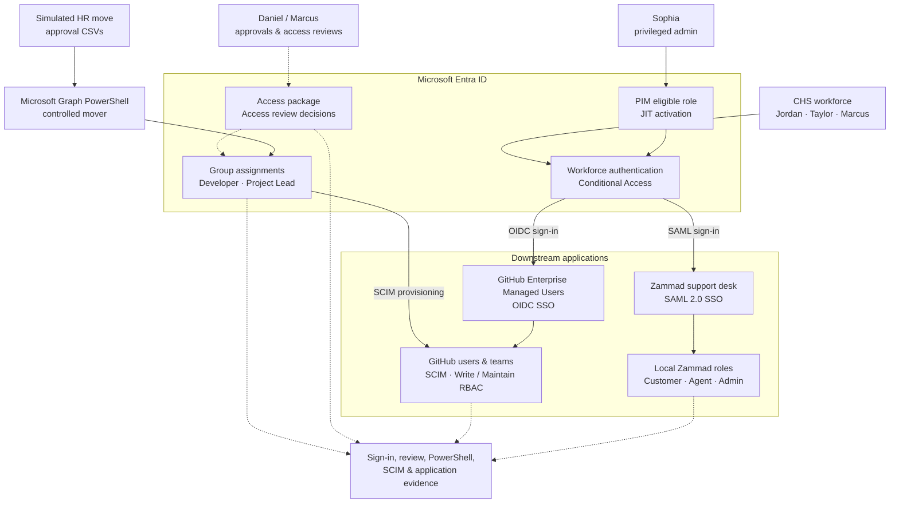

# Cedarbridge Health System | Identity architecture

One diagram shows the **implemented trust boundaries**. Solid paths represent configured or tested identity flows; dashed paths represent governance inputs and evidence. An access-review **decision** is not drawn as an automatic revocation.

**Important boundaries:** OIDC/SAML establishes authentication; SCIM synchronizes GitHub identities and groups; GitHub and Zammad enforce their own application permissions. Conditional Access has both enabled and Report-only policies. Review decisions were not demonstrated as automatically applied. The PowerShell mover required separate GitHub verification because SCIM propagation was asynchronous.
